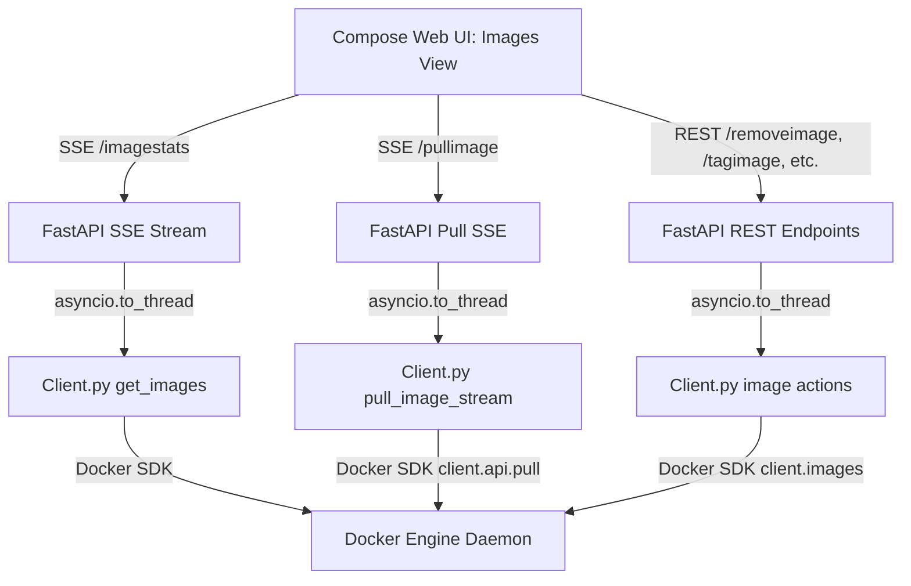

# Requirements

### Overview & Goals
The objective is to expand DockerWEB from container management to full-lifecycle Docker Image management. The interface and backend will provide real-time image inspection, telemetry, searching, layer-by-layer streaming pull progress, tagging, history inspection, container usage tracking, pruning, and deletion, adhering to the UI specification provided in the design mockup (`Images@1x.png`) and `docker-py` image management conventions.

### Scope
- **In Scope**:
  - Image inventory list with real-time stats (Total images, In use, Dangling, Disk used).
  - Search filtering by repository name, tag, or 12-character short Image ID.
  - Container usage correlation (identifying which active or stopped containers use each image).
  - Real-time streaming image pull with progress bar and layer status tracking.
  - Quick action controls: Run new container from image, Pull latest tag, Add custom Tag, View layer History, Inspect raw JSON metadata, Remove/Force-remove image.
  - Image maintenance actions: Prune unused/dangling images, Import/Load image archive from file path.
- **Out of Scope**:
  - Multi-registry credential management or Docker Hub push operations.
  - Image building from arbitrary remote Git repositories (building will remain an optional future phase).

### User Stories
- **As a Developer/DevOps Engineer**, I want to see all local Docker images with their disk consumption and container usage so that I can monitor disk utilization and clean up unused or dangling images.
- **As a Developer**, I want to pull new images with real-time visual progress of layer downloads so that I know exactly when images are ready to run.
- **As a Developer**, I want to inspect image configuration, inspect layer history, retag images, and immediately spin up containers from images directly in the web UI.

### Functional Requirements
1. **Summary Telemetry Cards**:
   - `Total images`: count of all local images.
   - `In use`: count of images referenced by at least one container.
   - `Dangling`: count of untagged/dangling images (`<none>:<none>`).
   - `Disk used`: aggregate virtual size of all images formatted in MB/GB.
2. **Pulling & Progress Streaming**:
   - Input text field accepting `<image>:<tag>` (e.g. `nginx:1.27`).
   - Progress bar displaying percentage and status (e.g., `redis:7 [======= ] 64% · 4 of 6 layers`).
3. **Image Inventory Table**:
   - Columns: `REPOSITORY`, `TAG`, `IMAGE ID`, `SIZE`, `CREATED`, `USED BY`, `ACTIONS`.
   - `USED BY` badges: green badge for running containers, muted gray badge for stopped containers, amber badge for `Unused`, orange/red badge for `Dangling`.
   - Action buttons per row: `Run`, `Pull latest`, `Tag`, `History`, `Inspect`, `Remove`.
4. **Action Modals & Dialogs**:
   - **Inspect Dialog**: formatted JSON view with syntax highlighting and copy-to-clipboard button.
   - **History Dialog**: structured view of image layers (Created, Created By instruction, Size).
   - **Tag Dialog**: inputs for new repository and tag strings.
   - **Run Dialog**: prompt to spin up a container detached from this image.
   - **Import Dialog**: input for local tar/archive path to load into Docker Engine.
   - **Prune Action**: triggers `client.images.prune()` with user feedback toast.

### Non-Functional Requirements
- **Low Latency & Non-blocking Concurrency**: All Docker SDK blocking calls run asynchronously in thread pools (`asyncio.to_thread`).
- **Real-time Updates**: Real-time SSE streaming for statistics and pull progress without page reloads.
- **Visual Consistency**: Adheres to the dark slate UI design system (`#1B2D44`, `#0B121B`, `#1F6FEB`) and typography of DockerWEB.

# Technical Design

### Current Implementation
- **Backend (`../../BackendLogic`, `../../BackendLogic`)**: Uses `docker.from_env()`. Currently contains container-specific logic (`client.containers.list()`, `stats()`, `stop()`, `restart()`, etc.) and streams container stats over SSE `/stats`.
- **Frontend (`DockerWebUI/`)**:
  - `AppState.kt` defines `SelectedMode.IMAGES`, but no UI view is currently rendered for this mode.
  - `DockerApi.kt` handles HTTP/SSE communication with the FastAPI backend on port `8081`.
  - `Views/RightPanelContainers.kt` conditionally checks `appState.contentToDisplay == SelectedMode.CONTAINERS` and only mounts container components.

### Key Decisions
1. **Image Telemetry & SSE Streaming**:
   - *Decision*: Provide a dedicated SSE endpoint `GET /imagestats` (and `GET /pullimage` for streaming pulls) alongside existing container telemetry.
   - *Rationale*: Isolating image telemetry ensures minimal payload overhead and prevents stats polling lag for images when container metrics refresh rapidly.
2. **Container-to-Image Correlation Strategy**:
   - *Decision*: Compute container associations in Python backend within `get_images()` by cross-referencing `client.containers.list(all=True)` against image IDs and tags.
   - *Rationale*: Offloading correlation to the backend prevents duplicate data transfer and ensures the UI receives pre-computed badge metadata (`name`, `status`, `short_id`).
3. **Pull Progress Tracking**:
   - *Decision*: Use Docker low-level API `client.api.pull(..., stream=True, decode=True)` to stream status dicts via SSE to the client.
   - *Rationale*: Allows real-time calculation of overall pull progress and layer completion (`X of Y layers`) matching the UI mockup.

### Proposed Changes
1. **`../../BackendLogic`**:
   - Implement `get_images()`, `pull_image_stream(name, tag)`, `remove_image(id, force)`, `tag_image(id, repo, tag)`, `prune_images()`, `inspect_image(id)`, `get_image_history(id)`, `import_image(path)`.
   - Clean up duplicate `close_shell` definition.
2. **`../../BackendLogic`**:
   - Expose `GET /imagestats` (SSE), `GET /pullimage` (SSE), `POST /tagimage`, `POST /removeimage`, `POST /pruneimages`, `GET /inspectimage`, `GET /imagehistory`, `POST /importimage`, `POST /runimage`.
3. **`DockerWebUI/shared/.../ImageData.kt`**:
   - Define data classes `ImageData`, `ContainerUsage`, `ImagePullProgress`, `ImageHistoryLayer`.
4. **`DockerWebUI/shared/.../DockerApi.kt`**:
   - Add API methods for image actions and SSE pull streaming.
5. **`DockerWebUI/shared/.../AppState.kt` & `App.kt`**:
   - Add `images = mutableStateListOf<ImageData>()` and pull state tracking.
   - Subscribe to `/imagestats` SSE in `App.kt`.
6. **`DockerWebUI/shared/.../Views/`**:
   - `ImagesStatsCards.kt`: Metric cards (Total, In use, Dangling, Disk used).
   - `ImagesTopBar.kt`: Search bar, Import button, Prune button, + Pull Image button.
   - `ImagesPullSection.kt`: Inline pull bar with live progress indicator.
   - `ImagesTable.kt`: Data table, color-coded badges, row actions, and modals (Inspect, History, Tag, Run, Remove).
   - `RightPanelContainers.kt`: Mount images UI when `contentToDisplay == SelectedMode.IMAGES`.

### Data Models / Contracts

#### Backend JSON Payload (`GET /imagestats`)
```json
[
  {
    "id": "sha256:a1b2c3d4e5f6...",
    "short_id": "a1b2c3d4e5f6",
    "repository": "nginx",
    "tag": "1.27",
    "size": 197132288,
    "created": "2025-02-10T12:00:00Z",
    "dangling": false,
    "used_by": [
      { "name": "web-nginx", "status": "running", "id": "e8a1f2c3d4e5" }
    ]
  }
]
```

#### Frontend Kotlin Models (`ImageData.kt`)
```kotlin
@Serializable
data class ContainerUsage(
    val name: String,
    val status: String,
    val id: String
)

@Serializable
data class ImageData(
    val id: String,
    @SerialName("short_id") val shortId: String,
    val repository: String,
    val tag: String,
    val size: Long,
    val created: String,
    val dangling: Boolean = false,
    @SerialName("used_by") val usedBy: List<ContainerUsage> = emptyList()
) {
    fun isUsed(): Boolean = usedBy.isNotEmpty()
    fun formattedSize(): String = formatBytesToHumanReadable(size)
    fun formattedCreatedRelative(): String = parseRelativeTime(created)
}
```

### Architecture Diagram


### File Structure
```
DockerLogic/
└── src/
    └── Client.py                  # [Modified] Add image operations & get_images
main.py                            # [Modified] Add /imagestats, /pullimage & REST endpoints
test_main.http                     # [Modified] Add image endpoint tests
DockerWebUI/shared/src/commonMain/kotlin/com/example/dockerwebui/
├── App.kt                         # [Modified] Connect SSE /imagestats
├── AppState.kt                    # [Modified] Add image list & pull progress state
├── DockerApi.kt                   # [Modified] Add image API methods
├── ImageData.kt                   # [Added] Data models for images, usage & pull events
└── Views/
    ├── ImagesStatsCards.kt        # [Added] 4 Telemetry cards
    ├── ImagesTopBar.kt            # [Added] Search & top action triggers
    ├── ImagesPullSection.kt       # [Added] Pull image input & live progress bar
    ├── ImagesTable.kt             # [Added] Image list table & interactive dialogs
    └── RightPanelContainers.kt    # [Modified] Switch between Containers & Images view
```

### Risks & Mitigations
- **Dangling Images Representation**: Dangling images have `<none>:<none>` tags. Mitigated by detecting empty/none tags, displaying `<none>` repository and tag placeholders with a distinctive orange/red `Dangling` badge.
- **Docker Pull Streaming Latency**: Pulling large multi-gigabyte images can take time. Mitigated by using SSE streaming for progress events so the UI updates smoothly without freezing.
- **Force Removal of In-Use Images**: Deleting an in-use image can fail if containers depend on it. Mitigated by providing clear error toasts and confirmation dialogs with a force-remove toggle option.

# Testing

### Validation Approach
Verification will be performed across backend endpoints and frontend components using automated HTTP tests, unit tests, and live validation against the Docker daemon.

### Key Scenarios
1. **Image Telemetry & Listing**:
   - Trigger `GET /imagestats` and verify response contains image items with correct `short_id`, `repository`, `tag`, `size`, `created`, `dangling`, and correlated `used_by` containers.
   - Verify that the four stats cards reflect accurate aggregate totals (Total images, In use, Dangling, Disk used).
2. **Search Filtering**:
   - Enter repository name, tag, and short ID into the search bar; verify table rows filter dynamically without lag.
3. **Image Pulling & Live Progress**:
   - Initiate pull for a lightweight test image (e.g., `alpine:latest` or `busybox:latest`) via `GET /pullimage`.
   - Verify that progress events stream properly and the progress bar animates to 100% completion.
4. **Image Tagging & Inspect**:
   - Add a custom tag to an existing image (e.g. `test/alpine:v1`) via `POST /tagimage`.
   - Verify image shows the updated tag and `GET /inspectimage` returns full JSON metadata.
5. **Layer History**:
   - Call `GET /imagehistory` for an image; verify that layer IDs, created timestamps, and build instructions are displayed in the modal.
6. **Container Launch (Run)**:
   - Click `Run` on an image row; verify a container instance is created and running.
7. **Pruning and Removal**:
   - Prune dangling/unused images via `POST /pruneimages`; verify dangling images are removed.
   - Remove an image via `POST /removeimage`; verify it disappears from the list.

### Edge Cases
- Image with `<none>` repository and tag (dangling image after rebuild).
- Removing an image that is currently in use by a running container (verify graceful error handling or force-remove workflow).
- Pulling an invalid or non-existent image name (verify error toast feedback).
- Rapid search query typing (verify smooth UI filtering without state corruption).

# Delivery Steps

### ✓ Step 1: Backend Image Operations and Logic
Backend data retrieval and image manipulation routines are established in DockerLogic.

- Add `get_images()` in `../../BackendLogic` to retrieve all local Docker images, calculate virtual sizes, human-readable created timestamps, dangling flags, and correlate running/stopped containers via `client.containers.list(all=True)` to populate container usage mapping.
- Implement image lifecycle actions in `Client.py`: `tag_image(id, repo, tag)`, `remove_image(id, force)`, `prune_images()`, `inspect_image(id)`, `get_image_history(id)`, and `import_image(file_path)`.
- Implement `pull_image_stream(repo_tag)` generator in `Client.py` using `client.api.pull(..., stream=True, decode=True)` to stream pull progress events (layer download/extraction percentages and layer counts).
- Fix minor concurrency and redundant code in `Client.py` (removing duplicate `close_shell`).

### ✓ Step 2: FastAPI Image REST & SSE Endpoints
FastAPI endpoints expose image telemetry, streaming pull updates, and REST operations.

- Add `GET /imagestats` SSE endpoint in `../../BackendLogic` streaming real-time JSON image metrics and container bindings to clients.
- Add `GET /pullimage` SSE endpoint in `../../BackendLogic` streaming real-time layer-by-layer pull progress events.
- Implement REST endpoints in `../../BackendLogic`: `POST /tagimage`, `POST /removeimage`, `POST /pruneimages`, `GET /inspectimage`, `GET /imagehistory`, `POST /importimage`, and `POST /runimage`.
- Add test definitions in `test_main.http` covering the new image management API endpoints.

### ✓ Step 3: Frontend Models, API Client & State Management
Client models, API client methods, and reactive state management for images are available in the Compose Web application.

- Create `ImageData.kt` in `DockerWebUI/shared/src/commonMain/kotlin/com/example/dockerwebui/` defining serializable models: `ImageData`, `ContainerUsage`, `ImagePullProgress`, and `ImageHistoryLayer` with helper functions for formatting size (`MB`/`GB`) and relative timestamps.
- Update `DockerApi.kt` with methods for pulling (`streamPullImage`), tagging, removing, pruning, inspecting, fetching history, and importing images.
- Extend `AppState.kt` with `val images = mutableStateListOf<ImageData>()` and reactive states for tracking active image pull progress and search query.
- Update `App.kt` to subscribe to the `/imagestats` SSE stream and update `AppState.images` dynamically.

### ✓ Step 4: Compose Multiplatform Images UI & Action Modals
The Images management interface displays telemetry cards, real-time pull controls, and the image inventory table matching the UI specification.

- Create `ImagesStatsCards.kt` rendering 4 summary cards: "Total images", "In use", "Dangling", and "Disk used".
- Create `ImagesTopBar.kt` containing header title, search filter field ("Search repository, tag, ID..."), "Import from file" button, "Prune unused" button, and "+ Pull Image" toggle button.
- Create `ImagesPullSection.kt` providing an inline image pull input field with a live progress bar showing percentage completion and layer status (`X of Y layers`).
- Create `ImagesTable.kt` rendering columns for Repository, Tag, Image ID, Size, Created, Used By (with color-coded container status badges, Unused, and Dangling badges), and Action buttons (Run, Pull latest, Tag, History, Inspect, Remove).
- Implement interactive modals in `ImagesTable.kt` for Inspect (JSON viewer with clipboard copy), History (layer timeline), Tag (repository/tag inputs), Run container, and Remove confirmation.
- Update `RightPanelContainers.kt` (or unified `RightPanel.kt`) to render the Images view when `appState.contentToDisplay == SelectedMode.IMAGES`.