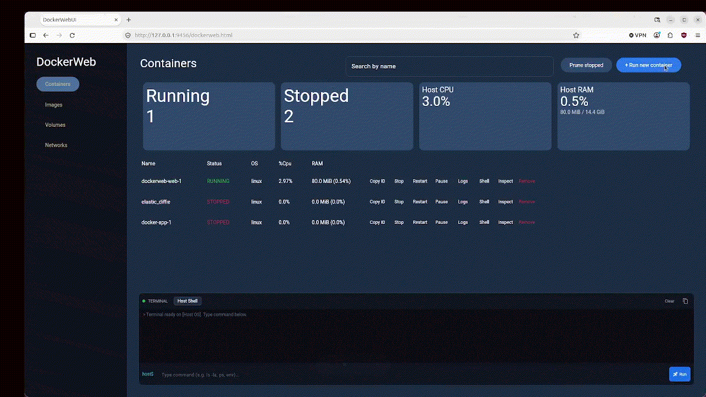

# DockerWEB

A web interface for managing a local Docker engine. Built with a Compose Multiplatform (WebAssembly) frontend and a Python FastAPI backend communicating via the Docker socket and Server-Sent Events (SSE).

## Demos

<details open>
<summary><b>1. Application Overview</b> (walkthrough of all main views)</summary>
<br>


</details>

<details>
<summary><b>2. Container Management</b> (running, managing, and removing containers)</summary>
<br>


</details>

<details>
<summary><b>3. Self-Removal & Error Handling</b> (removing the active DockerWEB container and browser connection error)</summary>
<br>


</details>

## Features

- **Containers:** View status metrics, start, stop, restart, pause, view logs, inspect JSON configuration, and run interactive shell commands.
- **Images:** Pull images with real-time download status, view layer history, tag, run, delete, and prune unused images.
- **Volumes:** Create local volumes, browse volume file trees, backup to host directories, clone data between volumes, and inspect configs.
- **Networks:** Create custom bridge networks, inspect IP/subnet assignments, and connect or disconnect running containers.

## Configuration

You can configure the backend host IP, port, and login credentials by editing `config.json` in the project root:

```json
{
  "host": "0.0.0.0",
  "port": 9456,
  "user": "admin",
  "password": "admin"
}
```

- **`host`**: The interface address for the backend server to bind to (e.g. `0.0.0.0` or a specific IP). When accessed from another host, the UI automatically connects to the server's hostname/IP.
- **`port`**: The port number for the backend server.
- **`user`**: Username required to sign in via the browser login screen.
- **`password`**: Password required to sign in via the browser login screen. Authentication is persisted for the current browser/server session via an `HttpOnly` session cookie and prompts again on the next session.

## Quickstart

### Option 1: Docker Compose

```bash
docker compose up --build
```

### Option 2: Docker CLI

```bash
docker build -t dockerweb .

docker run -d \
  -p 9456:9456 \
  -v /var/run/docker.sock:/var/run/docker.sock \
  --name dockerweb \
  dockerweb
```

Access the UI at `http://127.0.0.1:9456` (redirects automatically to `dockerweb.html`).

> [!WARNING]
> DockerWEB mounts the Docker socket and exposes shell execution endpoints behind cookie-based login.
> Change the default `admin` / `admin` credentials in `config.json` before use, and prefer HTTPS (e.g. via a reverse proxy) or binding to `127.0.0.1` when running on untrusted networks:
> ```bash
> docker run -d -p 127.0.0.1:9456:9456 -v /var/run/docker.sock:/var/run/docker.sock --name dockerweb dockerweb
> ```

### Local Development

#### 1. Backend (FastAPI)

Requires Python 3.14+ and `uv`.

```bash
uv sync
uv run uvicorn BackendLogic.src.main:app --port 9456 --reload
```

#### 2. Frontend (Compose Wasm)

Requires JDK 21+.

```bash
cd DockerWebUI

# Dev server with live reload:
./gradlew wasmJsBrowserDevelopmentRun

# Or build static assets for the backend to serve:
./gradlew :webApp:wasmJsBrowserDistribution
```
